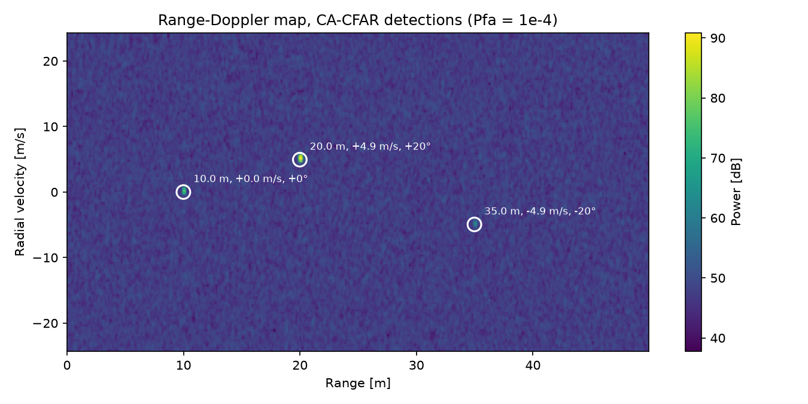

# radar-cuda

FMCW radar signal-processing chain - synthetic ADC cube -> range/Doppler FFTs -> CA-CFAR detection -> angle estimation. Tested NumPy reference, with CUDA port in progress.



Three simulated targets in complex Gaussian noise (amplitudes 1.0, 0.2, 0.05),
77 GHz, 1.2 GHz bandwidth, 128 chirps x 400 samples x 8 channels. Detections are reported at bin centers (0.125 m, 0.38 m/s, ~1.8° at boresight); no peak interpolation yet.

## Layout

| | |
|---|---|
| `src/radar/params.py` | `RadarParams`: chirp/frame parameters and derived resolutions |
| `src/radar/sim.py` | point-target beat-signal simulator, multi-target cube + noise |
| `src/radar/processing.py` | NumPy reference chain: `range_fft -> doppler_fft -> power_map -> ca_cfar_2d -> peaks -> angle_fft -> to_physical` |
| `tests/` | every stage tested against physics (bin positions, Pfa on pure noise, sign conventions) |
| `scripts/plot_rd.py` | produces the figure above |

## Running (NumPy Reference)

``` bash
uv sync
uv run pytest                    # run tests
uv run python scripts/plot_rd.py # results of script shown above
```

## Running (CUDA)

Needs NVIDIA GPU and CUDA >= 12; tests skip if module not built.

``` bash
cmake -B build -DCMAKE_BUILD_TYPE=Release -Dpybind11_DIR=$(uv run python -m pybind11 --cmakedir)
cmake --build ./build
uv run pytest tests/test_cuda.py
```

## Status

- [x] Numpy reference chain
- [x] cuFFT range-Doppler; matches NumPy to 2e-6 (float32)
- [ ] CA-CFAR stencil kernel, checked against NumPY reference
- [ ] per-stage timings
- [ ] real frames (RaDICal / ColoRadar)
